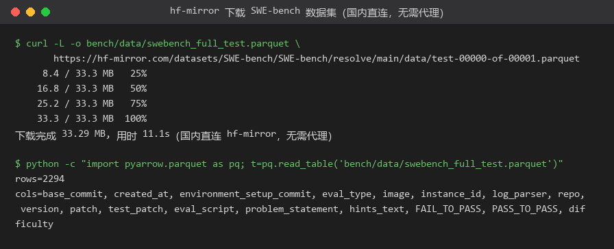
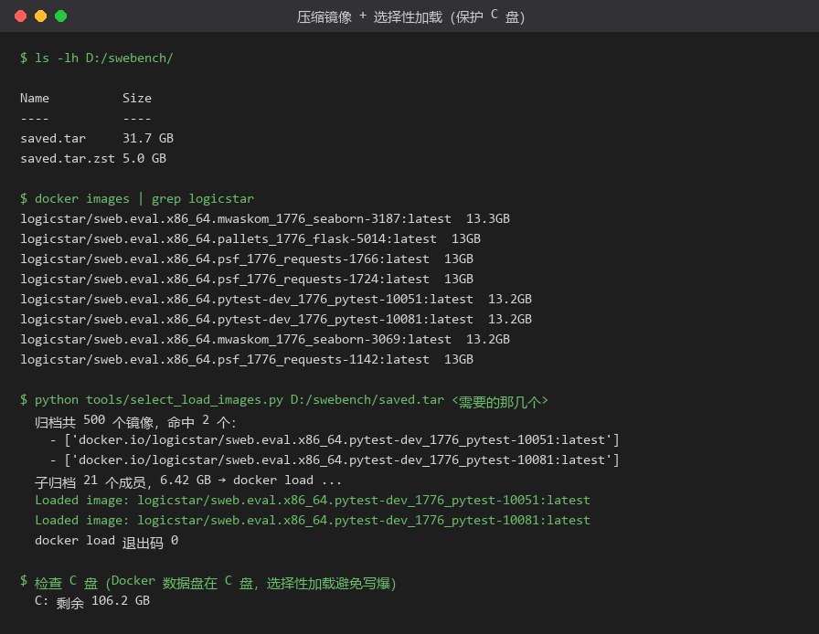
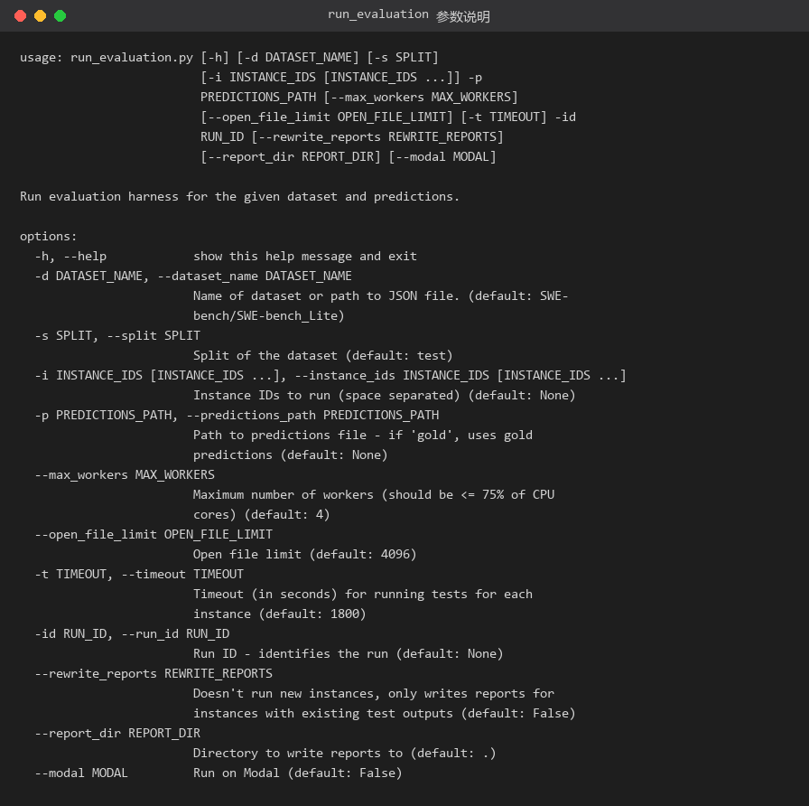
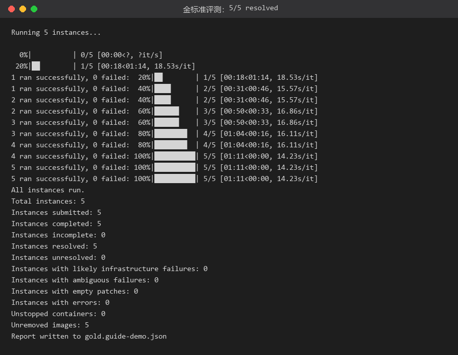
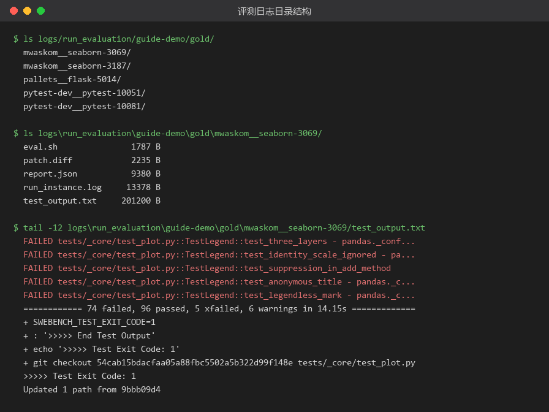
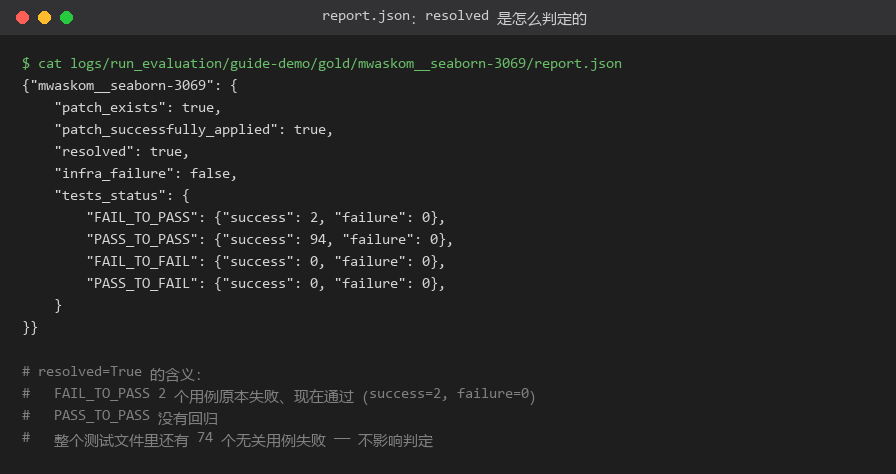
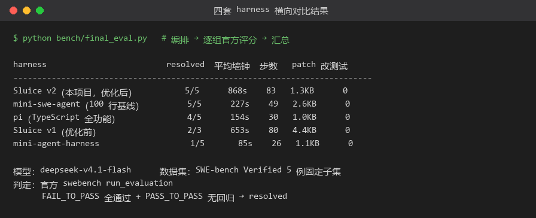

# SWE-bench 实战指南：从数据集到评测结果

> 面向「想在自己的机器（含 Windows）上跑通 SWE-bench」的人。
> 本文所有命令、输出、截图都来自真实运行：`swebench 5.0.2` + Windows 11 + Docker Desktop，
> 镜像走 LogicStar 压缩归档，数据走 hf-mirror，全程不需要代理。
>
> 配套脚本在 `bench/` 与 `tools/`，可直接复用。

---

## 0. 五分钟总览

SWE-bench 的评测是一条五段式流水线：

```
① 取数据集        ② 准备镜像          ③ 起容器跑 agent      ④ 收集 patch        ⑤ 官方评分
parquet 33MB  →  每个实例一个镜像  →  模型在 /testbed 修 bug →  git diff  →  FAIL_TO_PASS 是否通过
（2294 行）      （500 个 ×13GB）                           （JSONL）        （resolved = 是/否）
```

最小可跑通的命令序列（本文仓库内直接可用）：

```bash
# ① 数据：hf-mirror 下载（33MB）
curl -L -o bench/data/swebench_full_test.parquet \
  https://hf-mirror.com/datasets/SWE-bench/SWE-bench/resolve/main/data/test-00000-of-00001.parquet

# ② 镜像：下载压缩归档（5.4GB）→ 解压（31.7GB）→ 选择性加载
python tools/downloader.py https://hf-mirror.com/LogicStar/SWE-Bench-Verified-Compressed/resolve/main/saved.tar.zst D:/swebench/saved.tar.zst
python tools/load_images.py D:/swebench/saved.tar.zst                  # 或先解压再选择性加载
python tools/select_load_images.py D:/swebench/saved.tar logicstar/sweb.eval.x86_64.pallets_1776_flask-5014:latest

# ③ 选子集 → 生成本地数据集（把 image 指向本地镜像名）
python bench/subset.py pilot
python bench/build_dataset.py pilot

# ④ 先验证评分链路：用官方 gold patch 跑一遍，必须全 resolved
python -m swebench.harness.run_evaluation -p gold -d bench/dataset_pilot.jsonl -id gold-check --max_workers 2

# ⑤ 跑自己的 harness → 收集 patch → 评分
python bench/run.py --subset pilot --harness sluice
python bench/final_eval.py
```

---

## 1. SWE-bench 是什么

| 概念 | 说明 |
| --- | --- |
| **实例（instance）** | 一个真实 GitHub issue 修复任务：`仓库 + base_commit + 问题描述 + test_patch + FAIL_TO_PASS/PASS_TO_PASS` |
| **Verified 子集** | 人工筛选过的 **500 例**高质量实例，是目前的公认主基准 |
| **predictions** | 模型产出的 patch，一行一个实例，JSONL |
| **evaluation** | 把 patch 应用到干净仓库 → 跑测试补丁 → 检查指定用例是否由失败转通过、且无回归 |

一次「resolved」的判定只看两件事：

1. **FAIL_TO_PASS** 里的用例：修复前失败，修复后**全部通过**；
2. **PASS_TO_PASS** 里的用例：修复前后都通过，**不能回归**。

> ⚠️ 注意：**resolved ≠ 整个测试文件全绿**。实测 `seaborn-3069` 的测试输出里有 74 个无关用例失败，
> 但只要 FAIL_TO_PASS 的 2 个用例通过、PASS_TO_PASS 无回归，依然判定 resolved。
> 详见 [第 7 节](#7-看结果正确解读-reportjson)。

---

## 2. 环境准备

| 项 | 本文环境 | 说明 |
| --- | --- | --- |
| Python | 3.11.9 | `pip install swebench==5.0.2` |
| Docker | 29.9.2（WSL2 后端） | 每个实例跑一个容器 |
| 磁盘 | C 盘 107GB 空闲 / D 盘 211GB 空闲 | 压缩归档 5.4GB + 解压 31.7GB 放 D 盘 |
| 网络 | hf-mirror.com 直连 | 全程无代理 |

```bash
pip install swebench==5.0.2 pyarrow
python -c "import swebench; print(swebench.__version__)"   # 5.0.2
```

### 磁盘预算（关键）

| 方案 | 下载量 | 落盘量 | 说明 |
| --- | --- | --- | --- |
| 官方：`docker pull` 500 个镜像 | ~100GB+ | 31.7GB（共享层后） | Docker Hub 国内基本拉不动 |
| **压缩归档**（本文方案） | **5.4GB** | 31.7GB（解压后 tar） | 一次下载，离线反复用 |

---

## 3. 数据集：走 hf-mirror，33MB 搞定

### 3.1 下载

```bash
curl -L -o bench/data/swebench_full_test.parquet \
  https://hf-mirror.com/datasets/SWE-bench/SWE-bench/resolve/main/data/test-00000-of-00001.parquet
```



实测：33.29MB，11 秒下完，国内直连（`hf-mirror.com` 是 HuggingFace 的国内镜像，
把 `huggingface.co` 换成它即可，不需要代理、不需要 token）。

### 3.2 两个 parquet，别下错

| 文件 | 行数 | 列数 | 关键差异 |
| --- | --- | --- | --- |
| `SWE-bench/SWE-bench` → `data/test-*.parquet` | 2294 | **17** | ✅ 含 `image` / `eval_script` / `log_parser` / `eval_type` |
| `princeton-nlp/SWE-bench_Verified` → `test-*.parquet` | 500 | **13** | ❌ 没有 `image` 等字段 |

**这是最容易踩的坑**：swebench 5.x 的 `make_test_spec()` 需要 `image` 字段，直接拿 Verified 的
parquet 会报：

```
KeyError: 'image'
```

正确做法：用**新版 SWE-bench 数据集的 test 分片**（2294 行，包含全部 500 个 Verified 实例），
再用 Verified 的 id 列表筛出子集。实测 500/500 的 Verified id 都能在里面找到。

### 3.3 字段速查

| 字段 | 用途 |
| --- | --- |
| `instance_id` | 唯一标识，如 `pallets__flask-5014` |
| `repo` / `base_commit` | 仓库与起点 commit |
| `problem_statement` | 给模型看的 issue 描述 |
| `patch` | **官方 gold patch**（做金标准校验用） |
| `test_patch` | 评测时注入的测试改动 |
| `FAIL_TO_PASS` / `PASS_TO_PASS` | 判定用的用例清单（JSON 字符串） |
| `image` | 该实例的 Docker 镜像名（决定跑哪个环境） |
| `eval_script` | 容器内执行的评测脚本模板 |
| `eval_type` | 实测取值 `pass_and_fail` |

---

## 4. 镜像：三个坑与压缩方案

### 4.1 原方案的三个坑

1. **Docker Hub 不可达**：`registry-1.docker.io` 超时；国内加速器（daocloud / 1panel / rat.dev…）
   对 `swebench/*` 这类镜像要么白名单拒绝、要么根本没有。
2. **体积巨大**：每个实例一个镜像（约 13GB），500 个 = 下载 100GB+。
3. **架构敏感**：镜像名带 `sweb.eval.x86_64.` 前缀，跟平台绑定。

### 4.2 压缩归档方案

[LogicStar/SWE-Bench-Verified-Compressed](https://huggingface.co/LogicStar/SWE-Bench-Verified-Compressed)
把 500 个镜像打成一个 `saved.tar.zst`：**5.4GB 下载 → 31.7GB 解压 → 500 个镜像**。

```bash
# 下载（可用 tools/downloader.py，支持 Range 断点续传）
curl -L -o D:/swebench/saved.tar.zst \
  https://hf-mirror.com/LogicStar/SWE-Bench-Verified-Compressed/resolve/main/saved.tar.zst

# 解压（--long=31 是必须的：归档用了 2GB 窗口压缩）
zstd -d --long=31 -o D:/swebench/saved.tar D:/swebench/saved.tar.zst

# Windows 没有 zstd 命令行时，用 Python 等价实现（实测 95 秒解完 31.7GB）：
python -c "import zstandard,sys; d=zstandard.ZstdDecompressor(max_window_size=2**31); \
open('D:/swebench/saved.tar','wb').write(d.decompress(open('D:/swebench/saved.tar.zst','rb').read()))"
```

> 如果磁盘只够放一份，也可以跳过落地 tar：`tools/load_images.py` 是边解压边 `docker load` 的流式实现。

### 4.3 两种加载方式

**方式 A：全量加载**（31.7GB 全灌进 Docker）

```bash
zstd -d --long=31 --stdout D:/swebench/saved.tar.zst | docker load
# Windows 上建议用脚本，避免 PowerShell 管道破坏二进制流：
python tools/load_images.py D:/swebench/saved.tar.zst
```

**方式 B：选择性加载（推荐）**

Docker 的数据盘默认在 C 盘（`docker_data.vhdx`），动辄一两百 GB。**全量加载很容易把系统盘写爆**，
而且你可能只需要几个实例。`tools/select_load_images.py` 只从大 tar 里挑需要的镜像重建小归档：

```bash
python tools/select_load_images.py D:/swebench/saved.tar \
  logicstar/sweb.eval.x86_64.pallets_1776_flask-5014:latest \
  logicstar/sweb.eval.x86_64.mwaskom_1776_seaborn-3069:latest
```



实测：加载 8 个镜像后，C 盘剩余空间只从 107.2GB 降到 106.2GB（镜像层高度共享）；
而按 31.7GB 的解压体积估算，全量加载会一次性占掉约 30GB 系统盘。

### 4.4 镜像名规则（必须知道）

```
官方名:  swebench/sweb.eval.x86_64.psf__requests-1142:latest
压缩包:  logicstar/sweb.eval.x86_64.psf_1776_requests-1142:latest
                                        ↑ 双下划线换成 _1776_
```

原因：Docker 的仓库名不允许连续下划线（`__` 非法），
所以 SWE-bench 约定用 `_1776_` 代替 `__`。**你自己构造镜像名时必须做这个替换**。

`bench/build_dataset.py` 就是干这个的——它把数据集里的 `image` 字段改写成本地实际存在的镜像名：

```python
def logicstar_image(instance_id: str) -> str:
    return f"logicstar/sweb.eval.x86_64.{instance_id.replace('__', '_1776_')}:latest".lower()
```

---

## 5. 参数配置

### 5.1 `run_evaluation` 全参数

```bash
python -m swebench.harness.run_evaluation --help
```



| 参数 | 含义 | 建议值 |
| --- | --- | --- |
| `-p, --predictions_path` | 预测文件路径；**传 `gold` 表示用数据集自带的官方 patch** | 自己的 JSONL 或 `gold` |
| `-d, --dataset_name` | 数据集名或**本地 JSONL 路径** | `bench/dataset_pilot.jsonl` |
| `-s, --split` | 数据集分片 | 本地 JSONL 时忽略 |
| `-i, --instance_ids` | 只跑指定实例（空格分隔） | 调试时用，如 `pallets__flask-5014` |
| `-id, --run_id` | 本次运行标识，报告的 `run_id` 字段 | 每次不同，如 `cmp-v2` |
| `--max_workers` | 并发数 | 建议 ≤ CPU 核数 75%，本文用 2 |
| `-t, --timeout` | 单实例测试超时（秒） | 默认 1800，小仓库 900 足够 |
| `--report_dir` | 报告输出目录 | 默认 `.`（仓库根） |
| `--rewrite_reports` | 不重跑，只根据已有 test_output 重写报告 | 改判定逻辑后重算 |
| `--modal` | 传到 Modal 云上跑 | 本地有 Docker 就不需要 |

### 5.2 predictions 文件格式

一行一个实例，三个字段，**顺序无关**：

```jsonl
{"instance_id": "pallets__flask-5014", "model_name_or_path": "my-harness", "model_patch": "diff --git a/src/flask/blueprints.py ..."}
{"instance_id": "mwaskom__seaborn-3069", "model_name_or_path": "my-harness", "model_patch": "..."}
```

| 字段 | 说明 |
| --- | --- |
| `instance_id` | 必须和数据集一致 |
| `model_name_or_path` | 报告里的模型名，可当分组标签用 |
| `model_patch` | **标准 unified diff**，用 `git diff` 生成最稳妥 |

> ⚠️ **最大的坑：同一 `instance_id` 在一个文件里只能出现一次。**
> swebench 内部按 `instance_id` 建字典，重复的会被**覆盖**（只保留最后一条）。
> 我实测过：把「官方 gold patch」和「空 patch」用两个 model 名写进同一个文件，结果是
> `Instances resolved: 0`——因为最后一条空 patch 覆盖了 gold。
>
> **所以：多套 harness 做对比，必须分开跑（每组一个 predictions 文件），不能合并。**

### 5.3 本地数据集格式

要覆盖镜像名/评测脚本时，把数据集导出成 JSONL 再传 `-d` 指向它。
每行必须包含 `make_test_spec()` 需要的字段：

```json
{
  "instance_id": "pallets__flask-5014",
  "repo": "pallets/flask",
  "base_commit": "e6a1a1b...",
  "problem_statement": "...",
  "patch": "...",
  "test_patch": "...",
  "FAIL_TO_PASS": "[\"tests/test_blueprints.py::test_empty_name\"]",
  "PASS_TO_PASS": "[\"...\"]",
  "image": "logicstar/sweb.eval.x86_64.pallets_1776_flask-5014:latest",
  "eval_script": "#!/bin/bash\nset -uxo pipefail\n...",
  "log_parser": "parse_log_pytest",
  "eval_type": "pass_and_fail"
}
```

`bench/build_dataset.py` 生成的就是这个格式（直接把官方 parquet 行 + 改写后的 `image` 落成 JSONL）。

---

## 6. 运行

### 6.1 先跑金标准（强烈建议）

在跑任何模型之前，先用 `-p gold` 验证「数据 + 镜像 + 评分」这条链路是通的：

```bash
python -m swebench.harness.run_evaluation \
  -p gold -d bench/dataset_pilot.jsonl -id gold-check --max_workers 2
```



**必须 100% resolved**。如果不是，说明环境有问题（而不是模型不行），先排查再往下走。

### 6.2 跑自己的 harness

```bash
# 单实例调试
python -m swebench.harness.run_evaluation \
  -p my_preds.jsonl -d bench/dataset_pilot.jsonl \
  -i pallets__flask-5014 -id debug -t 900 --max_workers 1

# 全量
python -m swebench.harness.run_evaluation \
  -p my_preds.jsonl -d bench/dataset_pilot.jsonl -id full --max_workers 2
```

耗时参考（5 实例、2 并发）：金标准约 **1-2 分钟**；带模型跑一遍仓库测试通常是每个实例 15-20 秒。

### 6.3 Windows 上的两个致命坑

#### 坑 1：`eval.sh` 被写成 CRLF

swebench 用 `Path.write_text()` 落盘 `eval.sh` 再拷进容器。Windows 默认换行翻译会把 `\n`
变成 `\r\n`，于是容器里：

- heredoc 里的测试补丁带上 `\r` → `git apply` 失败
- `conda activate testbed` 失效 → `pytest: command not found`

**症状**：金标准 0/6 resolved，`test_output.txt` 里出现 `'test_requests.py\r'`。

**修复**：`python tools/patch_swebench_windows.py`（给两处 `write_text` 加 `newline="\n"`）。

#### 坑 2：日志按 GBK 写盘崩溃

```
UnicodeEncodeError: 'gbk' codec can't encode character '\xf8'
```

**修复**：跑之前设 `PYTHONUTF8=1`（PowerShell：`$env:PYTHONUTF8="1"`）。

> 这两个坑不修，评测结果会**完全不可信**——这点比模型选择重要得多。

---

## 7. 看结果：正确解读 `report.json`

### 7.1 控制台输出字段

| 字段 | 含义 | 异常时怎么查 |
| --- | --- | --- |
| `Instances submitted` | 实际提交的实例数 | 比预期少 → predictions 缺行或被去重 |
| `Instances completed` | 跑完的实例数 | 少于提交数 → 看 `infra_failure` |
| `Instances resolved` | **通过判定** | 主要指标 |
| `Instances unresolved` | 跑完了但没通过 | 看该实例的 `test_output.txt` |
| `Instances with empty patches` | patch 为空 | 模型没产出改动 |
| `Instances with errors` | 流程异常 | 看 `run_instance.log` |
| `Instances with likely infrastructure failures` | 环境问题 | 常见是镜像/网络 |
| `Unremoved images` | 镜像没被清理（只影响磁盘） | 可忽略 |

### 7.2 日志目录结构

```
logs/run_evaluation/<run_id>/<model_name>/<instance_id>/
├── eval.sh            # 实际在容器里执行的脚本（排查 CRLF 就看这个）
├── patch.diff         # 应用的模型 patch
├── report.json        # 单实例判定结果
├── run_instance.log   # 宿主侧流程日志
└── test_output.txt    # 容器内的完整测试输出（最有用）
```



### 7.3 `report.json` 与判定逻辑



```json
{"mwaskom__seaborn-3069": {
  "patch_exists": true,
  "patch_successfully_applied": true,
  "resolved": true,
  "infra_failure": false,
  "tests_status": {
    "FAIL_TO_PASS": {"success": 2,  "failure": 0},
    "PASS_TO_PASS": {"success": 94, "failure": 0},
    "FAIL_TO_FAIL": {"success": 0,  "failure": 0},
    "PASS_TO_FAIL": {"success": 0,  "failure": 0}
  }
}}
```

四个桶的含义：

| 桶 | 含义 |
| --- | --- |
| `FAIL_TO_PASS` | 修复前失败、**修复后应通过**（核心） |
| `PASS_TO_PASS` | 修复前后都应通过（**防回归**） |
| `FAIL_TO_FAIL` | 修复前后都失败（预期仍失败） |
| `PASS_TO_FAIL` | 修复前通过、修复后失败（**通常是新引入的破坏**） |

判定并非「全绿」：

```
resolved = patch 成功应用
        && FAIL_TO_PASS.failure == 0 && FAIL_TO_PASS.success > 0
        && PASS_TO_PASS.failure == 0
```

### 7.4 常见失败与排查顺序

1. **`patch_successfully_applied=false`** → patch 格式不对（不是 `git diff` 产物、或用了 CRLF）；
2. **`infra_failure=true`** → 镜像/网络/容器问题，先跑 gold 校验；
3. **`FAIL_TO_PASS` 有 success 也有 failure** → 修得不完整；
4. **`PASS_TO_FAIL` 非空** → 改动引入了回归；
5. **全 0** → 看 `test_output.txt` 里有没有 `command not found`（多半是 CRLF 导致环境没激活）。

---

## 8. 实战：四套 harness 横向对比

同一模型（`deepseek-v4.1-flash`）、同一 5 例子集、同一容器环境、统一 `git diff` 取 patch：



| harness | resolved | 平均墙钟 | 平均步数 | 平均 patch | 改测试文件 |
| --- | --- | --- | --- | --- | --- |
| Sluice v2（本项目，优化后） | **5/5** | 868s | 83 | 1.3KB | 0 |
| mini-swe-agent（100 行基线） | 5/5 | 227s | 49 | 2.6KB | 0 |
| pi（TypeScript 全功能） | 4/5 | 154s | 30 | 1.0KB | 0 |
| Sluice v1（优化前） | 2/3 | 653s | 80 | 4.4KB | 0 |
| mini-agent-harness | 1/5 | 85s | 26 | 1.1KB | 0 |

### 做公平对比的六个要点

1. **同一工作区**：把镜像里的 `/testbed` 复制到宿主，再 bind mount 回容器 `/testbed`，
   宿主的文件工具和容器的测试命令操作同一份文件；
2. **同一执行环境**：所有 harness 的 shell 都进同一个容器（自带 conda env），模型调用留在宿主；
3. **同一模型与预算**：同模型、temperature 0、相同步数上限；
4. **统一取 patch**：用 `git diff`，不用各 harness 自己的提交协议；
5. **基线锚定**：先给工作区打一个 baseline commit，否则镜像自带的脏改动会混进 patch；
6. **防作弊**：统计 patch 是否触碰测试文件（本文全部为 0）。

### 复现

```bash
python bench/subset.py pilot && python bench/build_dataset.py pilot
python bench/run.py --subset pilot --harness all
python bench/final_eval.py
```

---

## 9. FAQ

**Q：只想试一个实例，怎么做？**

```bash
python -m swebench.harness.run_evaluation -p gold -d <dataset>.jsonl -i <instance_id> -id t1 -t 900 --max_workers 1
```

**Q：`docker pull` 完全不动，有别的办法吗？**
用本文的压缩归档方案。国内 Docker Hub 基本不可用，加速器对 `swebench/*` 也不友好。

**Q：镜像名对不上（manifests unknown / no such image）怎么办？**
先 `docker images | grep sweb.eval` 看本地实际名字，再把数据集里的 `image` 字段改成一致的。
注意 `__` → `_1776_` 的替换规则。

**Q：评测跑得慢怎么办？**
`--max_workers` 调到 CPU 的 ~75%；单实例 `-t` 调小；用 `-i` 只跑想要的实例。
真正的瓶颈是每个实例都要起一个 13GB 镜像的容器。

**Q：报告里的 `Unremoved images` 是错误吗？**
不是。只是说镜像还在本地没被删，方便下次复用，不影响判定。

**Q：能在没有 Docker 的环境跑吗？**
不能——SWE-bench 的评测依赖每个实例的独立环境镜像。官方也提供 `--modal` 走云。

---

## 附录 A：本文用到的脚本

| 脚本 | 作用 |
| --- | --- |
| `tools/downloader.py` | 支持 Range 断点续传的下载器（大文件用） |
| `tools/load_images.py` | 把 `.tar.zst` 流式解压并 `docker load`（无需落地 31GB 临时文件） |
| `tools/select_load_images.py` | **选择性加载**：只从大 tar 里取需要的镜像，保护 C 盘 |
| `tools/patch_swebench_windows.py` | 修复 Windows 下 `eval.sh`/`patch.diff` 被写成 CRLF |
| `tools/term_shot.py` | 把终端输出渲染成图片（本文截图的生成器） |
| `bench/subset.py` | 按仓库挑选固定子集（确定性抽样） |
| `bench/build_dataset.py` | 生成本地数据集 JSONL（改写 `image` 指向本地镜像） |
| `bench/adapters/*` | 四套 harness 的统一接入层（同一工作区/容器/patch 口径） |
| `bench/run.py` | 驱动：harness × instance → patch + 指标 |
| `bench/final_eval.py` | 逐组跑官方评分并汇总对比表 |

## 附录 B：错误对照表

| 报错 | 原因 | 修复 |
| --- | --- | --- |
| `KeyError: 'image'` | 用了旧版 Verified parquet | 换 `SWE-bench/SWE-bench` 的 test 分片 |
| `git apply` 失败 + `\r` | eval.sh 被写成 CRLF | `tools/patch_swebench_windows.py` |
| `pytest: command not found` | conda 环境没激活（多半也是 CRLF） | 同上 + 确认 `eval.sh` 行尾 |
| `'gbk' codec can't encode` | Windows 默认编码 | `PYTHONUTF8=1` |
| `resolved: 0` 但 patch 是对的 | 同一 instance 被重复行覆盖 | 每个 instance 只保留一行 |
| `Failed to connect ... 443`（Docker Hub） | 国内网络 | 用压缩归档离线加载 |
| 镜像找不到 | 名字没做 `__`→`_1776_` 替换 | 改数据集里的 `image` 字段 |

---

*本文基于 2026-11 的实测环境编写；命令输出均来自真实运行，可直接对照复现。*
